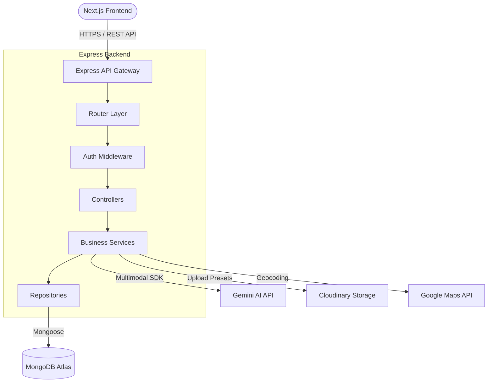
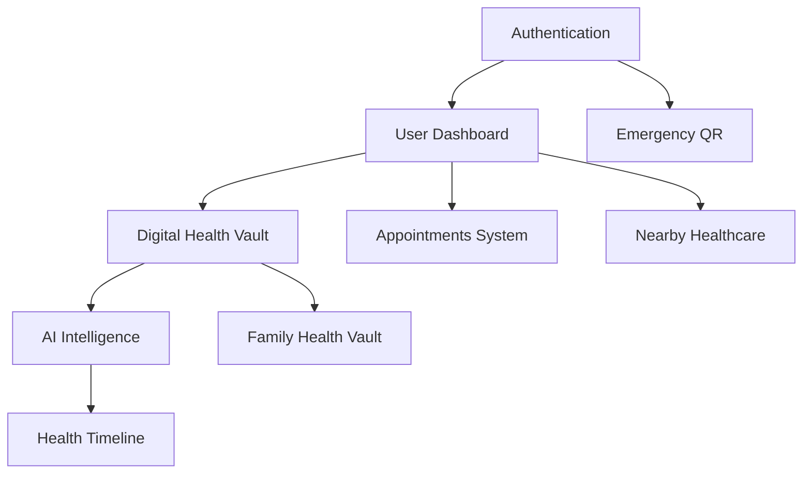
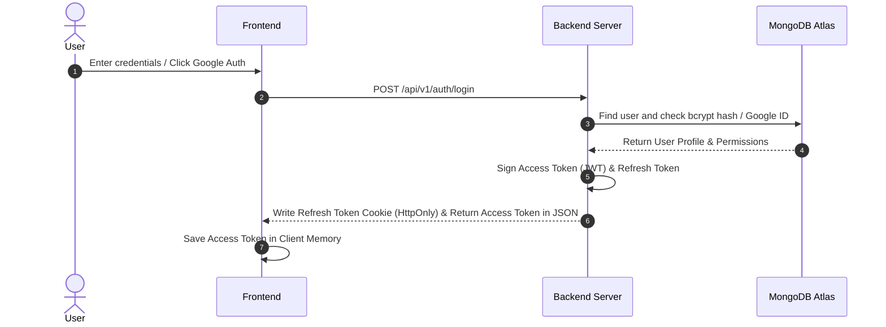
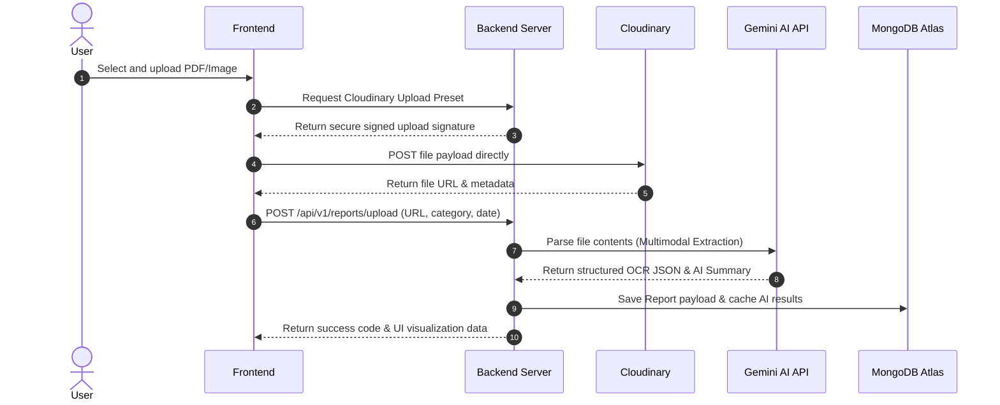
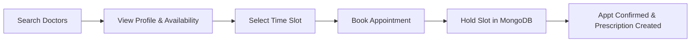

# LifeLedger Technical Specification (TECH_SPEC.md)

## 1. Executive Summary
LifeLedger is an AI-powered Personal Health Intelligence Platform. Its goal is to allow users to securely store medical records, generate visual health timelines, check drug interactions, compile context-aware health stories, and manage doctor appointments. It is designed to act as a personal digital health companion, strictly decoupling frontend presentation from backend logic with an emphasis on performance, data privacy, security, and scalability.

---

## 2. High-Level System Architecture
LifeLedger follows a decoupled client-server architecture model:
* **Frontend**: Built on Next.js 15, React 19, and TypeScript using a Feature-Based Architecture layout.
* **Backend**: Powered by Node.js, Express, and TypeScript adhering to Clean Architecture layers.
* **Data Layer**: Powered by MongoDB Atlas (database), Cloudinary (binary storage), and Redis (optional caching).
* **Integrations**: Gemini API (AI intelligence), Google Maps API (geospatial lookups).



---

## 3. Module Breakdown
1. **Landing & Authentication**: Credential logins, Google OAuth, Apple Login, and JWT access/refresh token generation.
2. **Dashboard**: Unified API aggregating widgets (Health Score, Notifications, Health Timeline Preview, Nearby Hospitals, Quick Actions).
3. **Digital Health Vault**: Handles file uploads to Cloudinary and OCR metadata cataloging in MongoDB.
4. **AI Intelligence**: Processes medical records via Gemini API to generate risk predictions, timelines, and health stories.
5. **Geospatial Proximity**: Identifies local clinics, blood banks, and hospitals using Google Maps API location metadata.
6. **Appointments & Scheduling**: Interactive scheduling and digital prescription creation.
7. **Family Health Vault**: Permission-based multi-user profile sharing.
8. **Emergency Systems**: Standard QR lookup profiles bypassing standard auth for emergency personnel.

---

## 4. Folder Structure
LifeLedger uses a clean split workspace:
```
LifeLedger/
├── frontend/             # Next.js 15 SPA
│   ├── src/
│   │   ├── app/          # App Router layouts and routes
│   │   ├── features/     # Encapsulated product modules (auth, timeline, vault)
│   │   ├── shared/       # Reusable components, hooks, utilities
│   │   └── providers/    # Global context & QueryClient configuration
├── backend/              # Express REST Server
│   ├── src/
│   │   ├── routes/       # Endpoint definitions
│   │   ├── controllers/  # Request validation and orchestration
│   │   ├── services/     # Pure business logic services
│   │   ├── repositories/ # MongoDB database access layer
│   │   ├── models/       # Mongoose schemas
│   │   └── middleware/   # Rate limiting, auth, errors
└── docs/                 # Product and technical specifications
```

---

## 5. Feature Dependency Graph


---

## 6. Authentication Flow
JWT Authentication uses two tokens: short-lived Access Tokens (in-memory) and long-lived Refresh Tokens (secure HttpOnly cookies).



---

## 7. AI Report Analysis Flow


---

## 8. Health Vault Flow
The Health Vault stores files in Cloudinary, while index search terms and categories reside inside MongoDB.
* **Search / Filter Query**: Evaluates database records via compound indexes `{ userId: 1, reportDate: -1 }` and Lucide text queries, bypassing slow manual search loops.

---

## 9. Doctor Appointment Flow


---

## 10. Google Maps Integration Flow
* Client passes GPS coordinates `(latitude, longitude)` or a query search term.
* Backend queries the `/hospitals` endpoint. It executes a `$geoNear` aggregation against the collection using a `2dsphere` index to locate nearby clinics within a specified radius (e.g., 5km).

---

## 11. Database Overview
Implemented inside MongoDB Atlas via Mongoose models:
* **User**: Core client records.
* **Doctor**: Specialized profiles referencing a parent `userId`.
* **MedicalReport**: Metadata repository holding Cloudinary URLs and AI analysis.
* **Appointment**: Scheduling tracker mapping Doctor and User IDs.
* **Prescription**: Detailed medical orders linked to an Appointment.
* **Hospital / Ambulance**: Proximity nodes marked with `2dsphere` location indexes.
* **HealthTimeline**: Chronological events linked to user reports.
* **FamilyMember**: Nested sharing schemas mapping owners to allowed permissions.
* **EmergencyQR**: Static medical profile lookups mapped to unique, high-entropy tokens.

---

## 12. API Overview
REST endpoint namespace is strictly nested under `/api/v1/`:
* `POST /auth/signup` | `POST /auth/login` (Auth Setup)
* `GET /dashboard` (Aggregated statistics & insights)
* `GET /reports` | `POST /reports/upload` (Digital Vault CRUD)
* `POST /ai/analyze` | `POST /ai/medicine-check` (AI processors)
* `GET /doctors` | `POST /appointments` (Booking engines)
* `GET /emergency/info?token=XYZ` (Public profile scanner lookup)

---

## 13. State Management Strategy
* **Server State**: Managed by **TanStack Query** (React Query) for API interactions, handling caching, updates, and automatic loading indicators.
* **Global Client State**: Controlled by lightweight **React Context** (restricted to theme values and active user auth status).
* **Local State**: Managed by standard React hook variables (`useState`, `useReducer`).

---

## 14. Error Handling Strategy
* **Backend**: Express routes are wrapped in a global exception handler. Uncaught operations return a structured JSON response `{ success: false, message: "Reason", error: {} }`. Stack traces are strictly masked in production modes.
* **Frontend**: Bound by React Error Boundaries at the feature root. Pages rendering API responses must deploy customized fallback components to present context-appropriate error recovery triggers.

---

## 15. Security Strategy
* JWT tokens are split: Access tokens stay in memory; Refresh tokens are housed in HTTP-only, secure, SameSite cookies.
* Headers are hardened via Express `helmet()`.
* Strict schema validation is enforced via `zod` on both client (React Hook Form) and server (Express parsing middleware) levels.
* Rate limiting applies to authorization endpoints.
* Emergency QR data is looked up via high-entropy tokens to prevent ID scanning attacks.

---

## 16. Performance Strategy
* Next.js pages leverage Server Components by default to decrease initial client bundles.
* Images are parsed through the Next.js `<Image />` component for optimization.
* Database operations use `.lean()` for read queries to skip heavy Mongoose document hydration.
* APIs returning large collections enforce query-based pagination.

---

## 17. Deployment Strategy
* **Frontend**: Deployed directly to **Vercel** with automatic caching.
* **Backend**: Node.js app runs on **Railway** or **Render** connected securely to MongoDB Atlas.
* **CI/CD**: Auto-deploys from GitHub branches (`main` auto-deploys to production; `dev` auto-deploys to staging environment).

---

## 18. Coding Standards
* Strictly typed interfaces (no `any` variables).
* Layout structures enforce DRY and modular composition design.
* UI components must natively adapt to Light, Dark, and System color schemes.

---

## 19. Testing Strategy
* **Unit Testing**: Jest/Vitest for testing utility functions, hooks, and services.
* **Component Testing**: React Testing Library to validate UI rendering and events.
* **Integration Testing**: Supertest to verify routes, API contracts, and database query executions on the backend.

---

## 20. Future Scalability
* Drafted schemas leave extensible attributes ready to append integrations such as Apple Health Kit sync payloads, Indian ABHA ID attributes, and wearable devices telemetry formats.
* Feature-based layout maps ensure new features can be added in `features/` without mutating existing codebase routes.
